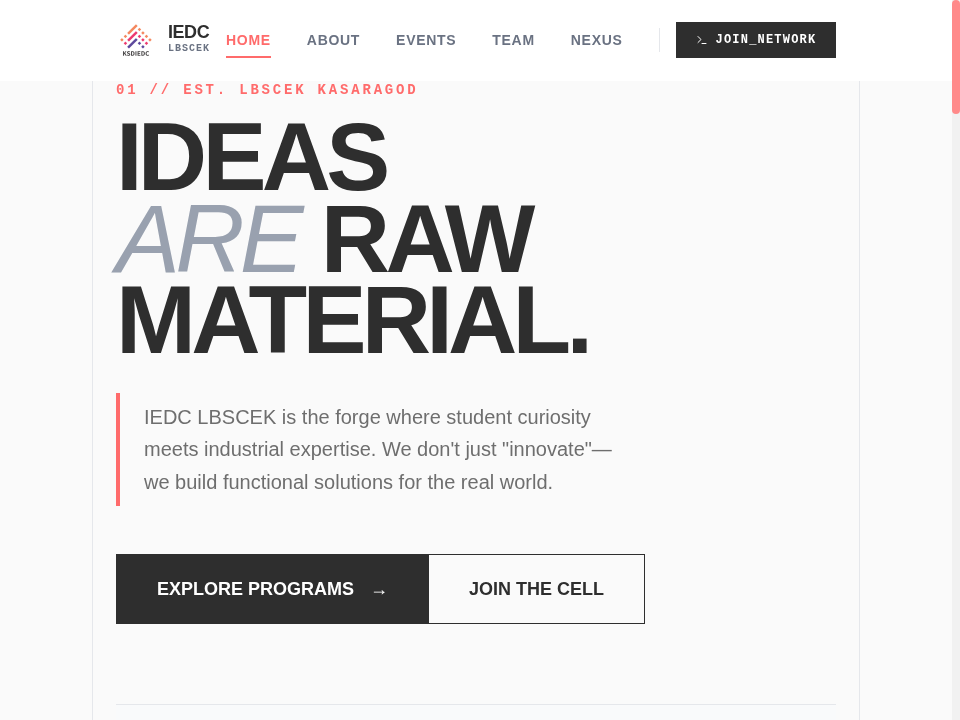
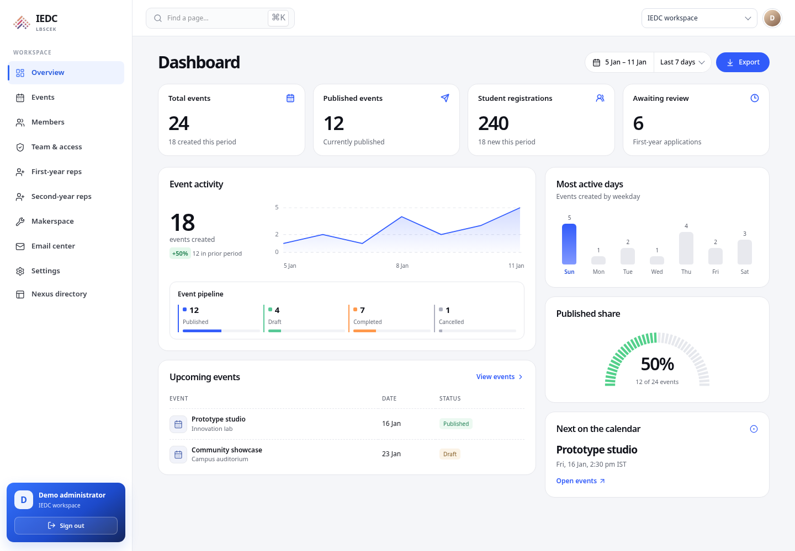

# IEDC LBSCEK Ecosystem

The website, administrative workspace and API for the Innovation and Entrepreneurship Development Cell at LBS College of Engineering, Kasaragod.

[Website](https://iedclbscek.in) · [Admin workspace](https://admin.iedclbscek.in) · [API documentation](https://api.iedclbscek.in/docs)

## Preview

### Public website



### Admin workspace

The dashboard below uses sample data. It does not show production members, events or operational totals.



## What it includes

- Public event listings, team profiles and community pages in Nexus.
- Membership registration and representative applications with email verification.
- An administrative workspace for members, events, team profiles, applications, attendance and email templates.
- Club workspaces with permissions delegated by club leads.
- A Nexus editor for arranging content and widgets, with separate draft and publication controls.

## Repository

| Location | Purpose |
| --- | --- |
| [`apps/main-site`](apps/main-site) | Public website built with React, Vite and Tailwind CSS |
| [`apps/admin-portal`](apps/admin-portal) | Administrative workspace built with React, Vite and TanStack Query |
| [`server`](server) | Express API, MongoDB models, authentication and integrations |
| [`shared`](shared) | Content rendering, validation and utilities shared across applications |
| [`docs`](docs) | Implementation notes and operational guides |

Dependency versions and runtime requirements are maintained in the package manifests and workspace lockfile.

## Local development

Use a Node.js release supported by the root [`package.json`](package.json) and the pnpm version declared in its `packageManager` field. A MongoDB instance is required for the API. Email and media-upload flows also require their corresponding service credentials.

```sh
git clone https://github.com/iedclbscek/iedc-ecosystem.git
cd iedc-ecosystem
pnpm install --frozen-lockfile

cp server/.env.example server/.env
cp apps/main-site/.env.example apps/main-site/.env
cp apps/admin-portal/.env.example apps/admin-portal/.env
```

Edit the copied files before starting the applications. For local development, use the following addresses consistently:

| File | Setting | Local value |
| --- | --- | --- |
| `server/.env` | `MONGO_URI` | Connection string for your development database |
| `server/.env` | `JWT_SECRET` | A generated secret for your development environment |
| `server/.env` | `ADMIN_PORTAL_URL` | `http://localhost:5174` |
| `server/.env` | `SWAGGER_SERVER_URL` | `http://localhost:5000` |
| `server/.env` | `COOKIE_DOMAIN` | Leave empty locally |
| `apps/main-site/.env` | `VITE_API_URL` | `http://localhost:5000` |
| `apps/admin-portal/.env` | `VITE_API_URL` | `http://localhost:5000/api` |
| `apps/admin-portal/.env` | `VITE_MAIN_SITE_URL` | `http://localhost:5173` |

Keep `NODE_ENV=development` and `PORT=5000` in the local server configuration. Set `ADMIN_MEMBERSHIP_ID`, `ADMIN_EMAIL` and a strong `ADMIN_PASSWORD` to provision the development admin account. Configure email and Cloudinary credentials when testing those integrations; see the [server guide](server/README.md).

Run each command from the repository root in a separate terminal:

```sh
pnpm --dir server dev
pnpm --dir apps/main-site dev --port 5173 --strictPort
pnpm --dir apps/admin-portal dev --port 5174 --strictPort
```

The website runs at `http://localhost:5173`, the workspace at `http://localhost:5174`, and the API documentation at `http://localhost:5000/docs` with these commands. The admin API URL includes `/api`; the public site's API URL does not.

## Validation

```sh
pnpm lint
pnpm test
pnpm build
```

Database-dependent tests require `TEST_MONGO_URI`. Use a separate local test database, never a production connection string:

```sh
TEST_MONGO_URI=mongodb://127.0.0.1:27017/iedc_test pnpm test
TEST_MONGO_URI=mongodb://127.0.0.1:27017/iedc_test pnpm --dir server test:release
```

Without `TEST_MONGO_URI`, database-dependent tests are skipped. The release smoke check starts the production-mode API against disposable local data; it does not verify external email delivery or media uploads.

## Deployment

The applications deploy as separate Vercel projects using their package directories as project roots. Build settings are stored in each package's `vercel.json`.

Configure environment variables per project. Frontend `VITE_*` values are included in the browser bundle and must not contain secrets. Database, authentication, email and Cloudinary credentials belong only in the server environment. Keep local environment files and database backups out of Git.

The [Swagger reference](https://api.iedclbscek.in/docs) documents API endpoints. The [OpenAPI document](https://api.iedclbscek.in/api-docs.json) is available for tooling.

## Contributing

Create a branch from the current upstream `main`, make a focused change, and open a pull request against [`iedclbscek/iedc-ecosystem`](https://github.com/iedclbscek/iedc-ecosystem). Include the relevant validation and screenshots for interface changes. Use sample data in screenshots and reports.

## License

This project is the property of IEDC LBSCEK. All rights reserved.
